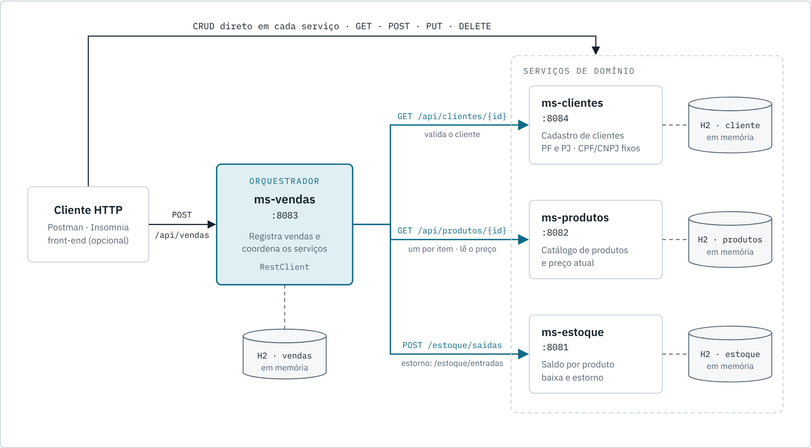
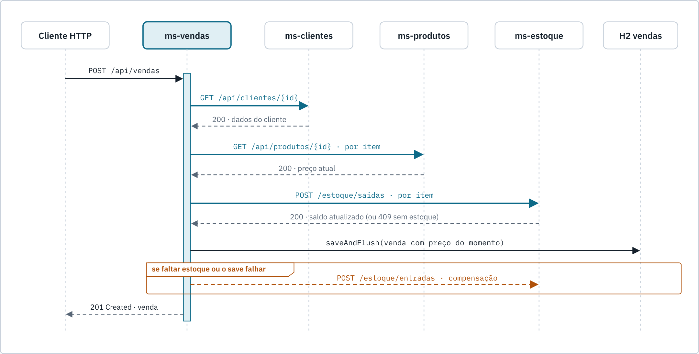

# Sistema de Vendas com Microsserviços

Repositório acadêmico com quatro aplicações Spring Boot independentes para os domínios de clientes, produtos, estoque e vendas. Cada serviço tem sua própria configuração, porta e banco H2.

## Microsserviços

| Serviço | Porta | API disponível | Estado atual | Documentação do Microsserviço |
| --- | ---: | --- | --- | --- |
| [`ms-clientes`](./ms-clientes) | `8084` | `/api/clientes` | CRUD de clientes pessoa física e jurídica. | [README de clientes](./ms-clientes/README.md) |
| [`ms-produtos`](./ms-produtos) | `8082` | `/api/produtos` | CRUD de produtos com validação de entrada. | [README de produtos](./ms-produtos/README.md) |
| [`ms-estoque`](./ms-estoque) | `8081` | — | Aplicação e entidade inicial; ainda sem API de estoque. | [README de estoque](./ms-estoque/README.md) |
| [`ms-vendas`](./ms-vendas) | `8083` | `/api/vendas` | Registro e cancelamento de vendas; orquestra clientes, produtos e estoque via `RestClient`. | [README de vendas](./ms-vendas/README.md) |

## Coleção do Postman

A coleção pode ser importada no Postman para executar cada requisição para verificar as operações disponíveis nos microsserviços

[Microsservicos-Testes.postman_collection.json](./docs/ARQ%20-%20Microsserviços.postman_collection.json)

## Tecnologias

- Java 21
- Spring Boot 4.1.2
- Spring Web MVC
- Spring Data JPA
- H2
- Maven (cada serviço tem seu próprio `pom.xml` e Maven Wrapper)
- Springdoc OpenAPI

## Executar

É necessário ter Java 21 instalado. Cada serviço pode ser iniciado separadamente, em um terminal próprio. No PowerShell, a partir da raiz do repositório, por exemplo:

```powershell
cd ms-produtos
.\mvnw.cmd spring-boot:run
```

Para iniciar outro serviço, use sua pasta (`ms-clientes`, `ms-estoque` ou `ms-vendas`) em outro terminal. Também é possível executar `mvn spring-boot:run` se o Maven estiver instalado.

## Persistência e dados de demonstração

Os serviços estão configurados com bancos H2 em memória, cada um com sua própria URL:

| Serviço | URL JDBC |
| --- | --- |
| Clientes | `jdbc:h2:mem:cliente` |
| Produtos | `jdbc:h2:mem:produtos` |
| Estoque | `jdbc:h2:mem:estoque` |
| Vendas | `jdbc:h2:mem:vendas` |

Clientes e produtos carregam dados de demonstração quando seus bancos estão vazios. Como os bancos são em memória, os dados são recriados ao iniciar o serviço e não sobrevivem ao encerramento do processo.

O console H2 está habilitado em `/h2-console` nos serviços. Para acessá-lo, informe a URL JDBC correspondente, usuário `sa` e senha em branco.

## Organização

Cada diretório `ms-*` é um projeto Maven separado. Nos serviços com CRUD implementado, o código segue camadas:

- `controller`: endpoints HTTP;
- `service`: operações do serviço e regras de negócio;
- `repository`: persistência via Spring Data JPA;
- `model`: entidades;
- `dto.request` e `dto.response`: contratos de entrada e saída;
- `exception`: respostas padronizadas de erro.

## Comunicação entre os microsserviços

O `ms-vendas` é o orquestrador. Ao receber `POST /api/vendas`, ele chama por HTTP:

1. `GET http://localhost:8084/api/clientes/{id}`: confirma o cliente;
2. `GET http://localhost:8082/api/produtos/{id}`: confirma cada produto e lê o preço atual;
3. `POST http://localhost:8081/estoque/saidas`: dá baixa em cada item;
4. grava a venda no próprio banco.

Se um passo falhar depois de alguma baixa, o `ms-vendas` devolve os itens com `POST /estoque/entradas` (compensação). Para a demonstração, inicie os quatro serviços e rode a pasta `ms-vendas` da coleção do Postman. Detalhes no [README de vendas](./ms-vendas/README.md).

## Arquitetura e fluxo planejado

Os diagramas abaixo ilustram a arquitetura e o fluxo de venda pretendidos:

### Diagrama de arquitetura



### Fluxo de venda


